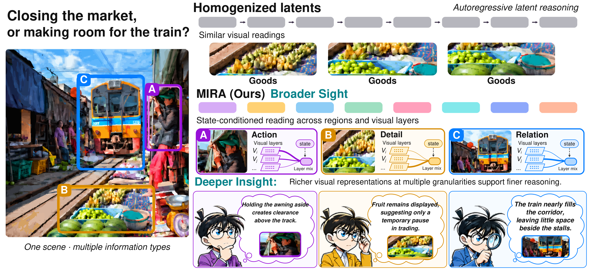
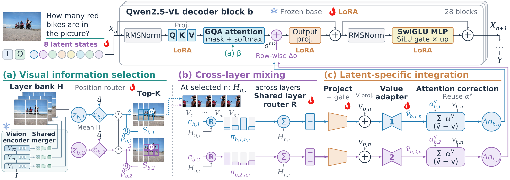
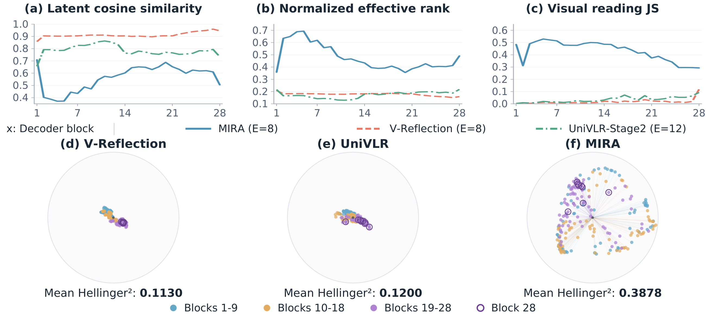
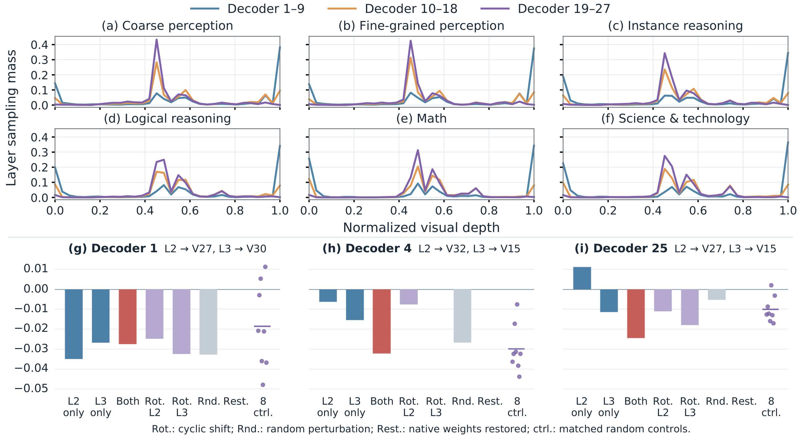
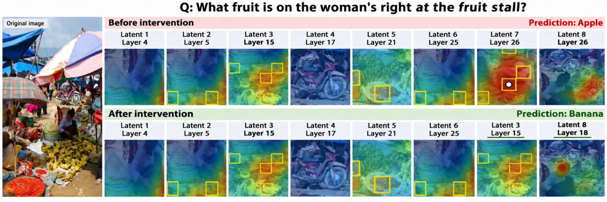
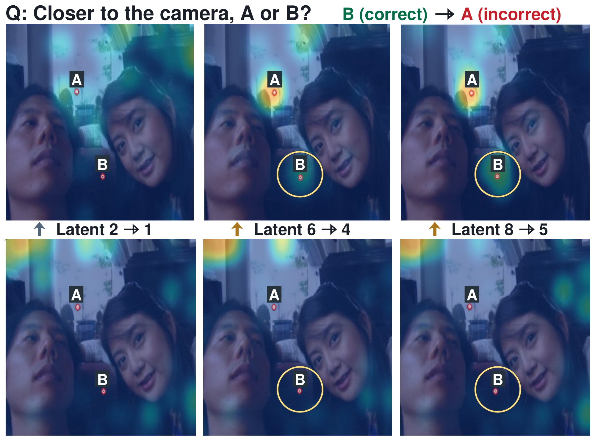

<div align="center">

# MIRA

### Broader Sight, Deeper Insight
**Mitigating Latent Homogenization through Visual Information Selection and Cross-Layer Mixing**

[Motivation](#motivation) · [Method](#method) · [Experiments](#experiments) · [Quick Start](#quick-start)

[](https://github.com/jinweiAi/MIRA/actions/workflows/tests.yml)
[](LICENSE)

</div>

MIRA is a parallel visual latent reasoning framework built on
**Qwen2.5-VL-7B-Instruct**. Each latent uses its evolving state and the question
to choose **where to read**, **which visual layers to read at each position**,
and **how to integrate the evidence** into its own state.

## Motivation

Visual latent reasoning can suffer from **latent homogenization**: different
latent states become highly similar and repeatedly read nearly the same visual
information. Adding latent computation then offers limited complementary
evidence for fine-grained visual reasoning. Parallel slots alone do not ensure
that their visual readings differ.

Our design principle is **Broader Sight, Deeper Insight**. Broader Sight gives
each latent access to relevant image regions and representations across visual
encoder layers. Deeper Insight integrates those representations through
latent-specific transformations, allowing different slots to build on different
evidence.

<a href="assets/figures/MIRA_Broader_Sight_Deeper_Insight.pdf">
  
</a>

*Conceptual motivation.* One scene can require evidence about actions, object
details, and spatial relations. MIRA selects both image content and the
representation used to read it. The illustrated roles explain the design
principle; they are not predefined labels assigned to the latent slots.
[View the original PDF](assets/figures/MIRA_Broader_Sight_Deeper_Insight.pdf).

## Method

<a href="assets/figures/MIRA_Framework.pdf">
  
</a>

MIRA inserts **eight learned parallel latent slots** between the image-question
context and the answer. A frozen visual encoder and shared pretrained merger
produce a spatially aligned bank containing **all 32 visual encoder layers**.
At each of the 28 language decoder blocks, MIRA performs three operations:

1. **Latent-conditioned spatial selection.** The current latent state and pooled
   original-question embedding score image positions. Each latent independently
   selects its Top-K positions, with a differentiable score prior retained in
   attention. The default reads 50% of positions, with at least two when available.
2. **Position-wise visual layer mixing.** For each selected position, a second
   router predicts a soft mixture over V1-V32. Two latents looking at the same
   location can therefore receive different representations of that location.
3. **Latent-specific evidence integration.** Low-rank projections map the mixture
   into the decoder's value space and augment the native visual Value. A
   slot-specific adapter transforms this evidence. A correction is added only
   to the receiving latent's attention output, preserving the shared K/V tensors
   and the backbone's residual and MLP updates.

The updated latent state conditions the next block's reading. Slots do not attend
to one another; answer queries can read the latent states.

**Two-stage training.** Stage I blocks direct text-to-image attention so that
visual information reaches answer prediction through the latent path. Stage II
continues from that checkpoint and restores native causal text-to-image access.
Spatial selection, layer mixing, and evidence integration remain active in both
stages. Training freezes the original backbone weights and updates decoder LoRA,
latent embeddings, routers, projections, and value adapters using **answer/EOS
cross-entropy**, without latent targets or auxiliary routing losses.

| Core component | Implementation |
| --- | --- |
| Spatial selection and per-position layer mixing | [`mira/routing.py`](mira/routing.py) |
| Evidence projection and slot-specific value adapter | [`mira/evidence.py`](mira/evidence.py) |
| Latent attention-output correction | [`mira/decoder.py`](mira/decoder.py) |
| Aligned multi-layer visual bank | [`mira/visual_bank.py`](mira/visual_bank.py) |
| Prefix assembly and two-stage topology | [`mira/prefix.py`](mira/prefix.py), [`mira/topology.py`](mira/topology.py) |

[View the original framework PDF](assets/figures/MIRA_Framework.pdf).

## Experiments

The study evaluates fine-grained perception, high-resolution understanding, and
multimodal reasoning across eight benchmarks. The tables below reproduce the
main manuscript's reported scores (%). **Bold identifies MIRA**, rather than
denoting the best score across every model family. UniVLR and V-Reflection are
the study's local reproductions; other baseline values follow the manuscript.

### Main results: visual perception

| Method | V* | HRBench-4K | HRBench-8K | MME-RealWorld-Lite | MMVP |
| --- | ---: | ---: | ---: | ---: | ---: |
| GPT-4o | 62.30 | 62.38 | 58.88 | 48.46 | 84.33 |
| Gemini-3-Flash | 86.91 | 90.75 | 88.38 | 62.22 | 85.33 |
| Qwen2.5-VL-7B | 76.44 | 67.38 | 63.75 | 43.82 | 65.67 |
| Qwen2.5-VL-7B + text-only SFT | 80.63 | 68.38 | 62.88 | 49.92 | 69.67 |
| LLaVA-OneVision | 69.63 | 65.12 | 57.50 | 45.49 | 77.00 |
| InternVL3-8B | 78.53 | 70.13 | 64.50 | 51.38 | 78.33 |
| Vision-R1 | 80.10 | 73.38 | 70.12 | 50.81 | 73.00 |
| ZoomEye | 83.77 | 70.00 | 65.63 | 47.06 | 71.33 |
| Thyme | 82.20 | 78.00 | 73.00 | 52.27 | 73.67 |
| DeepEyes | 83.25 | 73.00 | 66.63 | 53.93 | 73.67 |
| LVR | 80.60 | 69.90 | 66.90 | 39.10 | 72.00 |
| SkiLa | 77.50 | 70.30 | 62.90 | 45.60 | 71.70 |
| Monet | 79.10 | 71.90 | 63.50 | 46.90 | 68.00 |
| HyLaR | 80.63 | 73.13 | 67.25 | 47.33 | 71.00 |
| UniVLR | 73.82 | 73.30 | 68.80 | 43.04 | 70.00 |
| V-Reflection | 76.44 | 72.75 | 66.00 | 49.19 | 72.30 |
| **MIRA (ours)** | **79.06** | **74.88** | **67.90** | **51.90** | **72.67** |

Relative to Qwen2.5-VL-7B, the reported gains include **+7.50 points on
HRBench-4K**, **+8.08 on MME-RealWorld-Lite**, and **+7.00 on MMVP**.
MIRA has the highest HRBench-4K, MME-RealWorld-Lite, and MMVP scores among the
visual latent reasoning methods listed here. Gains are not uniform across all
benchmarks or subtasks.

### Main results: multimodal reasoning

| Method | BLINK reported aggregate* | MMStar | SEED-Bench-2-Plus |
| --- | ---: | ---: | ---: |
| GPT-4o | 51.1 | — | — |
| Qwen2.5-VL-7B | 54.5 | 59.7 | 65.3 |
| Qwen2.5-VL-7B + vanilla SFT | 53.1 | — | — |
| PAPO | 54.8 | 61.3 | 54.1 |
| Vision-R1 | 42.8 | 60.7 | 69.0 |
| Monet | 46.3 | 60.3 | 65.9 |
| DeepEyes | 52.7 | 58.7 | 69.1 |
| LVR | 55.4 | 51.9 | 47.4 |
| UniVLR | 50.2 | 42.8 | 53.2 |
| V-Reflection | 50.6 | 61.0 | 67.1 |
| **MIRA (ours)** | **55.8*** | **62.9** | **70.7** |

**Metric notes.** MMStar uses the reported format-normalized score; raw outputs
and normalization audits should be retained separately. Unresolved outputs remain
incorrect in the denominator. HRBench scores use the option-rotation evaluation
rows. MME Overall weights questions equally.

**\* BLINK scope:** the main table preserves the manuscript's reported aggregate
column. MIRA's **55.8** is the audited **selected-five-task micro accuracy:
389 / 697 = 55.81%**. It is **not** all-14-task Overall. That same run obtains
**1,031 / 1,901 = 54.23%** on all 14 tasks. The controlled Full MIRA ablation below
uses a separate matched evaluation, with **53.45%** all-14-task micro. These
quantities must not be interchanged, or reconstructed by averaging selected
subcategory scores. Baseline aggregates above are transcribed as reported in the
manuscript.

### Analysis: differentiated states and visual reading

<a href="assets/figures/mira_rq2_combined_corrected_compact.pdf">
  
</a>

MIRA shows lower inter-latent state cosine similarity, higher effective rank
normalized by latent count, and more diverse visual attention across decoder
depth. Panels (a-c) use eight slots for MIRA and V-Reflection and twelve for
UniVLR-Stage2. Panels (d-f) use **eight slots per method on 1,000 fixed questions**.
The final-block mean pairwise squared Hellinger distances in the original
attention space are **0.3878 for MIRA**, **0.1130 for V-Reflection**, and **0.1200
for UniVLR**. Greater diversity describes the measured representations and
readings; task accuracy is evaluated separately.
[Original PDF](assets/figures/mira_rq2_combined_corrected_compact.pdf).

### Analysis: visual-layer allocation and controlled interventions

<a href="assets/figures/mira_rq3_depth_and_intervention_compact.pdf">
  
</a>

The six task profiles summarize **1,500 MMStar questions**. Their vertical axis,
labeled "Layer sampling mass" in the figure, is **attention-weighted soft layer
mixture mass**, averaged over questions, latents, and decoder blocks in each
band. It is neither an argmax count nor a stochastic sampling frequency.
The horizontal axis is visual-encoder depth; the three curves group language
decoder blocks. Block 28 is excluded from these bands because its final latent
update cannot be consumed by a subsequent block for the first answer token.

Early blocks emphasize V32, while later blocks allocate more mass to intermediate
visual layers around V15-V18. The lower panels intervene on layer weights while
holding spatial routing fixed at the intervention block. Negative changes in the
correct-versus-incorrect log-support margin indicate reduced correct-answer
support. At D25, bidirectional exchange has a larger adverse effect than the
eight magnitude-matched random controls; restoring native weights recovers the
baseline. These interventions support a causal role for the tested
latent-to-layer assignments in answer computation.
[Original PDF](assets/figures/mira_rq3_depth_and_intervention_compact.pdf).

<details>
<summary><strong>Qualitative interventions: visual grounding and relative depth</strong></summary>

<a href="assets/figures/MIRA_Intervention.pdf">
  
</a>

**Visual grounding.** Redirecting the apple-biased read to banana-region evidence
from Latent 3, together with a change in the layer-specific representation,
corrects the generated answer from **Apple to Banana**.

<p align="center">
  <a href="assets/figures/Case2_Arrows_compact.pdf">
    
  </a>
</p>

**Relative depth.** Jointly replacing three native latent routes with other
latents' routes from the same image changes the generated answer from
**B (correct) to A (incorrect)**. This is a joint intervention, not an isolated
single-component test.

Together, these examples show that changing the visual evidence assigned to
latents can repair a grounding error or disrupt a correct relational decision
in the tested cases.

</details>

### Component and training ablations

The following is the manuscript's controlled ablation comparison. The latent
count and slot-specific integration remain fixed. Parentheses give changes
from Full MIRA in percentage points.

| Variant | HRBench-4K | MMStar | MME-RealWorld-Lite | BLINK all-14-task micro |
| --- | ---: | ---: | ---: | ---: |
| **Full MIRA** | **74.88** | **62.90** | **51.85** | **53.45** |
| w/o spatial selection | 72.63 (−2.25) | 61.10 (−1.80) | 51.38 (−0.47) | 52.87 (−0.58) |
| w/o layer mixing, V32-only evidence | 72.50 (−2.38) | 59.73 (−3.17) | 51.54 (−0.31) | 52.34 (−1.11) |
| Stage II throughout | 71.50 (−3.38) | 56.07 (−6.83) | 51.17 (−0.68) | 51.89 (−1.56) |

These comparisons test the contribution of spatial selection, adaptive layer
reading, and the initial training stage under the stated evaluation protocol.
The main tables and controlled ablations retain their respective reporting
precision and evaluation runs.

## Quick Start

### 1. Install

The supported environment is **Python 3.10, PyTorch 2.6.0, Transformers 4.51.3,
and PEFT 0.15.2**.

```bash
git clone https://github.com/jinweiAi/MIRA.git
cd MIRA
python -m venv .venv
source .venv/bin/activate

# Install PyTorch 2.6.0 and torchvision 0.21.0 for your CUDA environment.
pip install -e ".[test,eval]"
pytest -q
```

The implementation uses eager attention and one unpadded example per forward
pass. Gradient accumulation supplies the effective training batch size.

### 2. Prepare the backbone and data

Obtain **Qwen/Qwen2.5-VL-7B-Instruct** from its original distributor, or point
`--model` to a local copy. Create a JSONL manifest with one example per line:

```json
{"id":"example-001","images":["images/example.jpg"],"question":"What fruit is shown?\nA. Apple\nB. Banana\nAnswer with the option letter.","answer":"B","options":[{"label":"A","text":"Apple"},{"label":"B","text":"Banana"}],"category":"perception"}
```

Image paths are relative to the manifest directory. Put the benchmark's complete
prompt, options, and answer-format instruction into `question`. Training and
scoring require `answer`; inference does not read it.

```bash
mira-prepare-data --input data/raw_train.jsonl \
  --output data/train.jsonl --training
```

**Availability:** this repository includes code, configurations, and the figures
shown above. Base-model weights, MIRA checkpoints, datasets, and the original
static-10K training manifest are not bundled. Prepare the data and train a
checkpoint, or supply a compatible checkpoint that you already have. Training
on a different manifest does not reproduce the paper's checkpoint.

### 3. Train Stage I, then Stage II

```bash
CUDA_VISIBLE_DEVICES=0 mira-train --config configs/train/stage1.json
CUDA_VISIBLE_DEVICES=0 mira-train --config configs/train/stage2.json
```

The supplied configurations use eight latents, 50% spatial reading, all 32 visual
layers, router/projection/adapter widths of 128/128/32, decoder LoRA rank 16,
AdamW at 1e-4, and gradient accumulation of four. Each stage makes one pass over
the same 10,000-row manifest: **2,500 optimizer updates per stage**.
Stage II transfers Stage-I weights and resets the optimizer and scheduler.

Both configs default to `data/train.jsonl`; change the paths or use CLI overrides
for a local backbone and manifest:

```bash
mira-train --config configs/train/stage1.json \
  --model /path/to/Qwen2.5-VL-7B-Instruct \
  --manifest /path/to/train.jsonl --output-dir runs/stage1

mira-train --config configs/train/stage2.json \
  --model /path/to/Qwen2.5-VL-7B-Instruct \
  --manifest /path/to/train.jsonl --output-dir runs/stage2 \
  --resume runs/stage1/final.pt --resume-mode stage_transfer
```

Use matching backbone and manifest settings in both stages.
See [the detailed usage guide](docs/usage.md) for exact resume, checkpoint
compatibility, optimization settings, and implementation scope.

### 4. Generate answers

```bash
CUDA_VISIBLE_DEVICES=0 mira-infer \
  --checkpoint runs/stage2/final.pt \
  --model Qwen/Qwen2.5-VL-7B-Instruct \
  --manifest data/test.jsonl \
  --output outputs/predictions.jsonl \
  --max-new-tokens 16
```

Generation is greedy and uses the Stage-II topology. Set `--max-new-tokens` and
`--max-pixels` to the benchmark protocol. The example's 16-token cap is for short
multiple-choice answers, not every benchmark. The release recomputes the full
prefix at each token and does not implement a dynamic-routing KV cache.

Prediction records include the answer text and token IDs, TTFT, end-to-end
latency, peak allocated GPU memory, answer length, and truncation status.
Timing includes image preprocessing, visual encoding, bank construction,
latent computation, and generation; it excludes model loading.

### 5. Evaluate

For a prepared multiple-choice manifest:

```bash
mira-evaluate --manifest data/test.jsonl \
  --predictions outputs/predictions.jsonl \
  --output outputs/scores.json
```

This reports strict-letter and gold-blind format-normalized micro accuracy,
category scores, and a per-example parsing audit. Unresolved outputs remain in
the denominator. Use the benchmark's official evaluator for metrics such as
paired MMVP accuracy, MME subtotals, or other dataset-specific protocols.

An optional adapter integrates MIRA with a separately installed
[VLMEvalKit](https://github.com/open-compass/VLMEvalKit) checkout:

```bash
python scripts/eval_vlmeval.py --vlmeval-root /path/to/VLMEvalKit \
  --checkpoint runs/stage2/final.pt \
  --model Qwen/Qwen2.5-VL-7B-Instruct \
  --max-new-tokens 512 \
  --data MMStar --work-dir outputs/vlmeval
```

Follow VLMEvalKit's installation instructions and select a fixed revision for
reproducible comparisons. The dataset identifier for SEED-Bench-2-Plus is
`SEEDBench2_Plus`. Consult the [usage guide](docs/usage.md) for evaluation
protocol notes.

Code is released under [Apache-2.0](LICENSE). See
[third-party notices](THIRD_PARTY_NOTICES.md) for upstream components.
